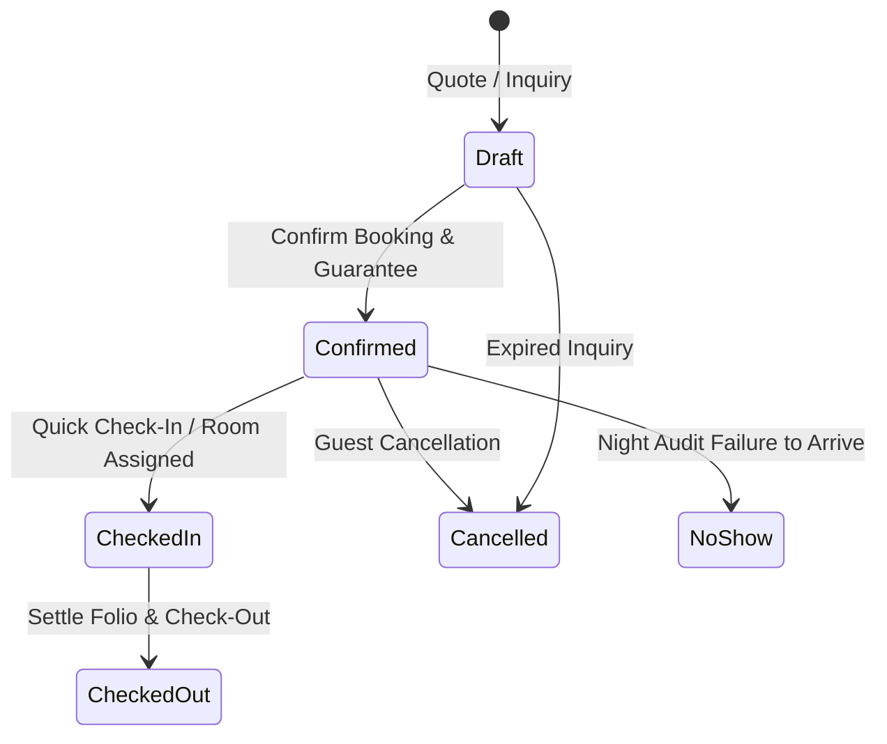

# Module 03: Guest CRM, Reservations & Front Desk Operations

## 1. Overview
The core operational heart of the PMS, handling guest profiles, reservation lifecycles, tape chart visibility, and streamlined front desk arrival/departure workflows.

## 2. Guest CRM 360 (`res.partner` Extension)
- **VIP Tiers:** Standard, Silver, Gold, Platinum, VVIP / Dignitary.
- **Identification & Regulatory Compliance:**
  - ID / Passport type, number, expiration date, issuing country.
  - Date of birth, nationality, gender.
- **Stay Preferences & Personalization:**
  - Bed type (King, Twin), floor location (High floor, Quiet corner, Ground floor).
  - Smoking vs Non-Smoking preference.
  - Allergies (feather pillows, food allergies, pet dander).
  - Dietary restrictions (Halal, Kosher, Vegan, Gluten-free).
- **Security & Blacklist Protocol:**
  - Flag for blacklisted guests with mandatory justification notes to protect property assets.
- **Lifetime Statistics:**
  - Total completed stays, lifetime spend, last departure date.

## 3. Reservation Lifecycle Machine (`hotel.reservation`)

## 4. Front Desk Operations & Wizards
### Quick Check-In Wizard (`hotel.checkin.wizard`)
1. Verifies guest identity and passport details.
2. Selects ready physical room (`status in ('available', 'clean', 'inspected')`).
3. Captures keycard electronic lock code.
4. Pre-authorizes optional security deposit and records it directly to the folio.
5. Transitions room status to `occupied` and creates/links `hotel.folio`.

### Quick Check-Out & Settlement Wizard (`hotel.checkout.wizard`)
1. Validates folio balance. Prevents departure if an outstanding balance exists.
2. Collects settlement payment (Cash, Terminal Card, Bank Transfer, Direct Billing, Mobile Money).
3. Verifies keycard return and minibar reconciliation.
4. Automatically flags physical room as `dirty` and spawns a departure cleaning task for housekeeping.
5. Marks reservation status as `checkout` and closes the folio.
