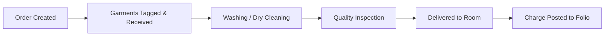

# Module 04: Laundry & Valet Service Management

## 1. Overview
This module automates guest laundry, dry cleaning, pressing, and valet garment tracking. It seamlessly interfaces with the guest's master folio for one-click billing.

## 2. Laundry Service Catalog (`hotel.laundry.service`)
- Categorized by garment type: Men's wear, Women's wear, Delicates, Linens.
- Service varieties:
  - Wash & Iron (Standard laundering)
  - Dry Cleaning (Chemical solvent cleaning)
  - Pressing / Ironing Only
  - Specialized Stain Removal
- Dynamic Pricing:
  - Base Standard Price (24-hour turnaround).
  - Express Rush Price (+50% automatic surcharge for 4-hour rush service).

## 3. Order Workflow (`hotel.laundry.order`)
1. **Draft Order:** Staff selects active reservation and room number.
2. **Received & Tagged:** Garments are counted, individual tags/barcodes logged, and special care instructions noted.
3. **Processing:** In-house laundry or dispatch to contracted external dry-cleaner partner (`vendor_id`).
4. **Ready:** Cleaned, pressed, packaged, and inspected.
5. **Delivered:** Handed back to the guest in their room.
6. **Charge to Folio (`action_post_to_guest_folio`):**
   - Directly creates an itemized line on the guest's active `hotel.folio`.
   - Locks the order from further modification or duplicate billing.

